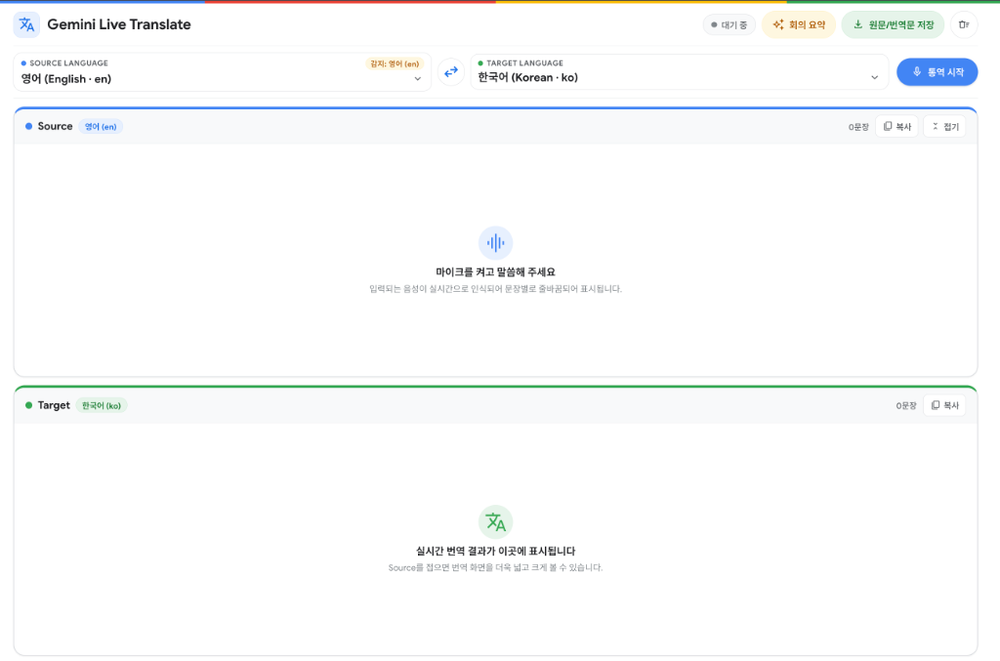
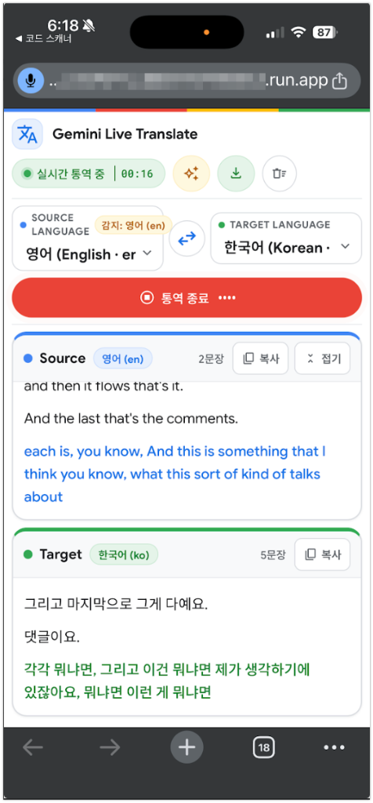

# Google Gemini 3.5 Live Translate Application

`gemini-3.5-live-translate-preview` 모델과 Google GenAI SDK (`google-genai`)를 활용하여 구현한 **실시간 자막 통역(Live Transcript Translation)** 반응형 웹 애플리케이션입니다. 데스크톱 웹과 iPhone / Android 모바일 브라우저에서 별도 앱 설치 없이 동작하며, AirPods 입·출력 분리가 필요한 경우를 위해 선택형 [iOS 네이티브 앱](#-ios-네이티브-앱-선택)을 함께 제공합니다.

---

## 🖥️ 화면 구성

<table>
  <tr>
    <th width="70%">데스크톱 웹 (대기 상태)</th>
    <th width="30%">모바일 웹 — iPhone Chrome (통역 중)</th>
  </tr>
  <tr>
    <td></td>
    <td></td>
  </tr>
</table>

| 영역 | 설명 |
| :--- | :--- |
| **상단 헤더** | 세션 상태(`대기 중` / `실시간 통역 중` + 경과 시간 / 재연결 중), `회의 요약`(.md 회의록 즉시 저장), `원문/번역문 저장`(.md 기록 즉시 저장), 기록 초기화 — 모바일에서는 아이콘만 표시 |
| **언어 컨트롤 바** | Source 언어(자동 감지 시 감지 언어 배지 표시) ⇄ Target 언어 선택, **`번역 음성 듣기` 토글**(ON 시 이어폰 출력 + `echoCancellation: false`), `통역 시작` / `통역 종료` 버튼 |
| **Source 패널 (위)** | 인식된 원문이 문장 단위로 실시간 표시 (진행 중 문장은 파란색). `복사`, `접기`(접으면 최신 한 줄만 미리보기로 남고 Target 패널이 확장) |
| **Target 패널 (아래)** | 번역문이 문장 단위로 실시간 표시 (진행 중 문장은 초록색). `복사` |

> 모바일 브라우저에서는 HTTPS(Cloud Run 배포 URL)로 접속해야 마이크 권한이 허용됩니다.

---

## ✨ 주요 기능

1. **Gemini 3.5 Live Translate 전용 모델 연동 (`gemini-3.5-live-translate-preview`)**
   - `echo_target_language=False` 기본값 (입력 음성이 이미 Target 언어여도 번역 경로로 처리. `True`로 설정 시 번역 대신 원어 그대로 전사)
   - `input_audio_transcription` 및 `output_audio_transcription` 동시 스트리밍
   - 16kHz 16-bit Mono PCM 마이크 입력을 WebSocket으로 서버에 스트리밍
2. **자막 전용 모드 & `번역 음성 듣기` 토글 (아이폰 AirPods 입·출력 분리 아키텍처 지원)**
   - **기본 상태 (`번역 음성 듣기` OFF)**: 하울링 없이 자막(원문/번역문)만 실시간 표시하며 `echoCancellation: true`로 동작합니다.
   - **`번역 음성 듣기` ON**: Gemini Live API가 생성하는 번역 음성(24kHz PCM)을 이어폰(AirPods 등)으로 실시간 스트리밍 재생하며, 회의실 원거리 발화자 음성이 통화 필터로 감쇠되지 않도록 **`echoCancellation: false`로 자동 전환**됩니다.
   - **iOS 네이티브 하이브리드 앱 ([`ios/`](ios/README.md))**: `WKWebView` 내부 `getUserMedia` 대신 네이티브 `AVAudioSession`(`.allowBluetoothA2DP` + `setPreferredInput(.builtInMic)`) 및 `AVAudioEngine` 브릿지를 사용하여, **AirPods을 착용한 상태에서도 마이크 입력은 100% 아이폰 본체 내장 마이크(회의실 수음), 번역 음성 출력은 100% AirPods(고음질 A2DP)**으로 완전 분리합니다.
3. **Source / Target 언어 설정 및 양방향 전환 (`⇄`)**
   - **Source Language**: 기본값 `English (en)` + `🌐 자동 감지` + 공식 지원 **78개 전체 언어(BCP-47)** (자동 감지 시 실시간 감지 언어 배지 표시)
   - **Target Language**: 기본값 `Korean (ko)` + 공식 지원 **78개 전체 언어(BCP-47)**
   - 통역 진행 중 언어를 변경하거나 `⇄` 스왑 버튼을 누르면 마이크를 끄지 않고도 백엔드에서 세션을 무중단 재연결합니다.
4. **Live API 세션 관리 (장시간 연속 통역 지원)**
   - `ContextWindowCompressionConfig(sliding_window=SlidingWindow())`: 장시간 통역 시 토큰 한계 방지
   - `SessionResumptionConfig(handle=...)` 및 `GoAway` 메시지 감지: 연결 수명 만료 전후로 세션 핸들을 이용해 끊김 없이 자동 재연결
   - 모바일 백그라운드 전환/네트워크 끊김 후 `session_id` 기반 자동 복구, 10분 무음 시 자동 종료
5. **원클릭 회의록 / 기록 저장 (`.md`)**
   - **`회의 요약`**: 누적된 대화를 바탕으로 `핵심 주제·개요 / 안건별 논의 사항 / 결정 사항·Action Items` 구조의 회의록을 생성하여 즉시 `.md` 파일로 저장 (`POST /api/summarize`). 요약 길이는 원본 분량에 비례해 자동 조절되며, STT 오인식 가능성이 있는 약어는 임의로 풀이하지 않습니다.
   - **`원문/번역문 저장`**: 전체 원문(Source) → 전체 번역문(Target) 순으로 분리 기록된 `.md` 파일을 즉시 저장
6. **프로젝트 구성에 맞춘 인증 방식 선택 (`AUTH_MODE`)**
   - `adc`: Cloud Run 프로젝트와 Gemini 프로젝트가 같을 때. Application Default Credentials로 Vertex AI의 Gemini를 호출합니다 (로컬: `gcloud auth application-default login`, Cloud Run: 서비스 계정).
   - `secret_manager`: 두 프로젝트가 다를 때. Secret Manager에 저장된 사용자 OAuth 자격증명으로 `GEMINI_PROJECT`를 호출하며, 액세스 토큰은 만료 15분 전에 자동 갱신되어 장시간 WebSocket 세션 중에도 끊기지 않습니다.

---

## 📁 프로젝트 구조

```text
live-translate/
├── app/
│   ├── __init__.py
│   ├── config.py          # 환경변수(.env), ADC/API Key 클라이언트 팩토리, 로그인 설정, 78개 지원 언어 정의
│   └── main.py            # FastAPI 서버, 로그인 게이트, /ws/translate 양방향 스트리밍(자막+번역오디오), /api/summarize
├── static/
│   ├── index.html         # 반응형 웹/모바일 UI (번역 음성 듣기 스위치 토글 포함)
│   ├── login.html         # 로그인 화면
│   ├── styles.css         # Google 4-Color (#4285F4, #EA4335, #FBBC05, #34A853) + 화이트 테마
│   └── app.js             # iOS Native Audio Bridge + Web Audio 16kHz 캡처/24kHz 재생, echoCancellation 연동
├── ios/                   # iPhone 네이티브 하이브리드 앱 (입력=아이폰 본체 마이크 / 출력=AirPods A2DP 분리)
│   ├── LiveTranslateApp.xcodeproj
│   ├── LiveTranslateApp/
│   │   ├── LiveTranslateApp.swift
│   │   ├── ContentView.swift
│   │   ├── NativeAudioBridge.swift  # AVAudioSession (.allowBluetoothA2DP + .builtInMic) & AVAudioEngine
│   │   └── Info.plist
│   └── README.md
├── docs/
│   ├── screenshot-main.png   # README용 데스크톱 화면 캡처
│   └── screenshot-mobile.png # README용 모바일(iPhone) 화면 캡처
├── Dockerfile             # Cloud Run 컨테이너 빌드
├── .dockerignore
├── .env.example           # 환경변수 템플릿
├── requirements.txt       # Python 패키지 의존성
└── README.md
```

---

## ⚙️ 환경변수 (`.env`)

`.env.example`을 복사하여 `.env`를 만들고 값을 채웁니다. `.env`는 Git 및 Cloud Build 업로드에서 제외됩니다.

```bash
cp .env.example .env
```

```dotenv
# 인증 모드
#   adc            : Cloud Run 프로젝트 == Gemini 프로젝트 (Cloud Run 서비스 계정 ADC로 호출)
#   secret_manager : Cloud Run 프로젝트 != Gemini 프로젝트 (Secret Manager의 사용자 OAuth 자격증명으로 호출)
#   api_key        : Gemini Developer API 키
AUTH_MODE=adc

# [공통] Cloud Run 배포 프로젝트 (secret_manager 모드에서는 Secret Manager 프로젝트)
GOOGLE_CLOUD_PROJECT=<YOUR_GCP_PROJECT_ID>
GOOGLE_CLOUD_LOCATION=global

# [secret_manager 필수] Gemini 호출 프로젝트 및 사용자 OAuth 자격증명 시크릿 ID
# (adc 모드에서는 GEMINI_PROJECT를 비워두면 GOOGLE_CLOUD_PROJECT 사용, USER_CREDENTIALS_SECRET은 무시)
GEMINI_PROJECT=
USER_CREDENTIALS_SECRET=<YOUR_SECRET_ID>

# [api_key 전용]
GEMINI_API_KEY=

# Model Configuration
LIVE_TRANSLATE_MODEL=gemini-3.5-live-translate-preview
SUMMARY_MODEL=gemini-3.8-flash

# Session Management Configuration
# Inactivity timeout in seconds (Default: 600s = 10 minutes)
INACTIVITY_TIMEOUT_SECONDS=600

# Login Gate (fixed shared password entered on the login page; leave empty to disable login)
APP_LOGIN_PASSWORD=change-me
# Secret for signing login cookies (any long random string). Keep stable across deploys.
# Generate with: openssl rand -hex 32
APP_SESSION_SECRET=
# Login session lifetime in hours
APP_SESSION_HOURS=12
```

| 변수 | 설명 |
| :--- | :--- |
| `AUTH_MODE` | `adc`: Cloud Run 프로젝트와 Gemini 프로젝트가 **같을 때** (서비스 계정 ADC). `secret_manager`: 두 프로젝트가 **다를 때** (Secret Manager의 사용자 OAuth 자격증명, 로드 실패 시 ADC로 대체하지 않고 오류). `api_key`: Gemini API 키. 잘못된 값이면 시작 시 오류 |
| `GOOGLE_CLOUD_PROJECT` | Cloud Run 서비스가 배포되는 프로젝트. `secret_manager` 모드에서는 시크릿(`USER_CREDENTIALS_SECRET`)이 있는 프로젝트 (예: `your-cloud-run-project-id`) |
| `GEMINI_PROJECT` | Gemini 모델을 호출하는 프로젝트. `secret_manager` 모드에서 **필수** (예: `your-gemini-project-id`). `adc` 모드에서는 비워두면 `GOOGLE_CLOUD_PROJECT` 사용 |
| `USER_CREDENTIALS_SECRET` | `secret_manager` 모드 전용. `GOOGLE_CLOUD_PROJECT`의 Secret Manager에 등록된 사용자 인증키 시크릿 이름. 시크릿에서 OAuth2 자격증명을 읽어 만료 전 자동 갱신 |
| `APP_LOGIN_PASSWORD` | 로그인 화면에서 입력할 고정 비밀번호. Cloud Run에서 비어 있으면 앱이 **공개 상태**가 되며 시작 시 CRITICAL 로그를 남김 |
| `APP_LOGIN_DISABLED` | `true`이면 로그인 게이트를 명시적으로 끔 (로컬 개발/의도적 공개 배포용) |
| `APP_SESSION_SECRET` | 로그인 쿠키를 HMAC 서명하는 서버 전용 비밀키. 비워두면 프로세스마다 랜덤 생성되어 **재시작/다중 인스턴스 시 로그인이 풀리므로** 운영 환경에서는 반드시 고정값을 지정 |
| `APP_SESSION_HOURS` | 로그인 쿠키 유효 시간 |

> 실제 환경변수(Cloud Run `--set-env-vars` / `--set-secrets`)가 `.env` 값보다 우선합니다. `.env`는 컨테이너 이미지에 포함되지 않으므로 Cloud Run에는 반드시 환경변수/시크릿으로 전달하세요.

---

## 💻 로컬 실행 방법

### 1. 사전 준비

- Python 3.11 이상
- Google Cloud SDK (`gcloud`) 및 ADC 로그인

```bash
# Vertex AI 호출용 ADC 인증
gcloud auth application-default login
```

### 2. 가상환경 및 의존성 설치

```bash
python3 -m venv .venv
./.venv/bin/pip install -r requirements.txt
```

### 3. 서버 실행

```bash
./.venv/bin/uvicorn app.main:app --host 0.0.0.0 --port 8000 --reload
```

브라우저에서 **[http://localhost:8000](http://localhost:8000)** 으로 접속하면 로그인 화면이 표시되고, `APP_LOGIN_PASSWORD`를 입력하면 통역 화면으로 이동합니다.

---

## ☁️ Cloud Run 배포 방법

### 1. 사전 준비

```bash
gcloud auth login
gcloud config set project <YOUR_GCP_PROJECT_ID>
```

다음 API가 활성화되어 있어야 합니다: Cloud Run, Cloud Build, Artifact Registry, Vertex AI (`secret_manager` 모드는 Secret Manager 추가).
Cloud Run 서비스 계정(기본: Compute Engine 기본 서비스 계정)에 필요한 권한은 `AUTH_MODE`에 따라 다릅니다.

| `AUTH_MODE` | 필요한 권한 |
| :--- | :--- |
| `adc` | `GOOGLE_CLOUD_PROJECT`에서 **`roles/aiplatform.user`** |
| `secret_manager` | `USER_CREDENTIALS_SECRET` 시크릿에 대한 **`roles/secretmanager.secretAccessor`** (Gemini 호출 권한은 시크릿에 저장된 사용자 계정 기준) |

### 2. 배포

`.env`의 값을 셸 환경변수로 로드한 뒤 `--set-env-vars`로 전달합니다. `AUTH_MODE=adc`이면 Cloud Run 서비스 계정으로 같은 프로젝트의 Gemini를 호출하고, `AUTH_MODE=secret_manager`이면 Secret Manager의 `USER_CREDENTIALS_SECRET`을 조회해 `GEMINI_PROJECT`로 Gemini를 호출합니다.

```bash
set -a; source .env; set +a

gcloud run deploy live-translate \
  --source=. \
  --project="${GOOGLE_CLOUD_PROJECT}" \
  --region=asia-northeast3 \
  --allow-unauthenticated \
  --port=8080 \
  --memory=1Gi \
  --cpu=1 \
  --timeout=3600 \
  --concurrency=25 \
  --min-instances=0 \
  --max-instances=1 \
  --session-affinity \
  --no-cpu-throttling \
  --set-env-vars="AUTH_MODE=${AUTH_MODE},GOOGLE_CLOUD_PROJECT=${GOOGLE_CLOUD_PROJECT},GOOGLE_CLOUD_LOCATION=global,GEMINI_PROJECT=${GEMINI_PROJECT},USER_CREDENTIALS_SECRET=${USER_CREDENTIALS_SECRET},LIVE_TRANSLATE_MODEL=${LIVE_TRANSLATE_MODEL},SUMMARY_MODEL=${SUMMARY_MODEL},INACTIVITY_TIMEOUT_SECONDS=${INACTIVITY_TIMEOUT_SECONDS},APP_LOGIN_PASSWORD=${APP_LOGIN_PASSWORD},APP_SESSION_SECRET=${APP_SESSION_SECRET},APP_SESSION_HOURS=${APP_SESSION_HOURS}" \
  --quiet
```

| 옵션 | 이유 |
| :--- | :--- |
| `--region=asia-northeast3` | 서울 리전 (모델 호출은 `GOOGLE_CLOUD_LOCATION=global`로 별도 라우팅) |
| `--allow-unauthenticated` | 브라우저에서 직접 접속. 앱 자체 로그인 게이트가 접근을 제어 |
| `--timeout=3600` | 장시간 WebSocket 통역 세션 유지 (최대 60분/요청) |
| `--session-affinity` | 재연결 시 같은 인스턴스로 라우팅하여 인메모리 세션 핸들 재사용 |
| `--no-cpu-throttling` | 요청 사이에도 CPU 유지 → WebSocket 스트리밍 안정화 |

배포가 끝나면 `Service URL: https://live-translate-<hash>.asia-northeast3.run.app` 형태의 주소가 출력됩니다. HTTPS이므로 모바일 브라우저에서도 바로 마이크 권한이 동작합니다.

---

## 📱 iOS 네이티브 앱 (선택)

모바일 웹만으로도 통역은 가능하지만, iPhone 브라우저(`getUserMedia`)는 AirPods 연결 시 오디오 세션을 통화용 HFP로 전환해 **입력과 출력이 모두 AirPods으로 묶입니다**. [`ios/`](ios/README.md)의 하이브리드 앱은 이 문제를 해결합니다.

- **입·출력 분리**: 네이티브 `AVAudioSession`(`.playAndRecord` + `.allowBluetoothA2DP`, HFP 비활성화)과 `AVAudioEngine` 브릿지로 **마이크 입력은 iPhone 본체 내장 마이크(회의실 수음)**, **번역 음성 출력은 AirPods(고음질 A2DP)**로 분리합니다.
- **동일한 웹 UI 재사용**: `WKWebView`로 배포된 Cloud Run 서버를 열고, [`static/app.js`](static/app.js)가 네이티브 브릿지를 감지하면 웹 마이크 대신 네이티브 16kHz PCM 캡처 / 24kHz 재생을 사용합니다.
- **간편 연결**: 첫 실행 시 QR 코드로 서버 URL을 설정합니다 (`https://`만 허용, `*.run.app` 외 호스트는 확인 후 전환).
- **안정성**: 전화·Siri 인터럽션, 이어폰 연결/분리, 백그라운드 전환 시 수음 자동 일시정지/재개.
- **빌드**: Xcode에서 `ios/LiveTranslateApp.xcodeproj`를 열고 Signing Team 설정 후 실기기에 설치합니다.

> 아키텍처, Swift ↔ JS 콜백 계약, 보안 정책, 빌드/설치 절차 등 상세 내용은 **[ios/README.md](ios/README.md)** 를 참고하세요.

---

## 🔌 API 요약

| 경로 | 설명 |
| :--- | :--- |
| `GET /` | 통역 화면 (로그인 필요) |
| `GET /login`, `POST /api/login` | 로그인 게이트 (IP당 5분 내 10회 실패 시 `429`) |
| `GET /healthz` | 헬스 체크 (로그인 불필요) |
| `GET /api/config` | 기본 언어/지원 언어 목록 등 UI 설정 |
| `WS /ws/translate` | 16kHz PCM 업스트림 + 원문/번역문 자막 다운스트림. 종료 코드: `4401` 로그인 필요, `4400` 잘못된 파라미터, `4403` 허용되지 않은 Origin. 치명적 오류는 `{"type":"error","fatal":true}` 전송 후 종료 |
| `POST /api/summarize` | 대화 기록 기반 회의록(Markdown) 생성 (최대 5,000개 항목/40만 자, 초과 시 `413`) |

> Cloud Run 환경(`K_SERVICE` 설정 시)에서는 `/docs`, `/openapi.json`이 비활성화됩니다.
